# Utviklingslogg – Balanse

Denne loggen viser hvordan appen ble til med vibe coding i Claude Code, fra første idé til dagens versjon.
For hver versjon står det hva jeg ba om, hva KI-en gjorde, hvordan appen ble testet, og skjermbilder.
Tilbakemeldingene mine er gjengitt i omskrevet og mer formell form, ikke ordrett.

Alle versjonene finnes i koden:
- **Versjon 1** ligger urørt i mappen [`versjon-1/`](../versjon-1/) og i git-taggen `v1`.
- **Versjon 2** ligger urørt i mappen [`versjon-2/`](../versjon-2/) og i git-taggen `v2`.
- **Versjon 3** ligger urørt i mappen [`versjon-3/`](../versjon-3/) og i git-taggen `v3`.
- **Versjon 4** ligger i mappen [`versjon-4/`](../versjon-4/), med forbedringene som kom etter v4, og i git-taggen `v4`.
- **Versjon 5** er hovedappen i rotmappen (git-taggen `v5`).

---

## Versjon 1 – første fungerende app

### Idé

Jeg beskrev ideen slik: «Balanse» skal samle studier og trening i én ukeplan. Appen skal kjenne eksamensdatoer og treningsmål.
I rolige uker foreslår den mer trening. Når eksamen nærmer seg, reduseres treningsintensiteten og lesetiden økes, uten at
treningen kuttes helt, siden trening bidrar til lavere stress og bedre konsentrasjon. Det skal også være mulig å logge søvn
og stressnivå, slik at planen kan justeres etter dette.

### Hva KI-en gjorde

- Foreslo å lage en **PWA (web-app)** som kan legges på hjemskjermen på mobilen, uten app-butikk.
- Skrev planleggingslogikken i `plan.js`: eksamenspress per dag, lesetid, treningsintensitet (Hard/Moderat/Lett),
  aktive pauser og justering etter søvn og stress.
- Lagde fire faner: **Uke**, **Logg**, **Eksamener** og **Mål**, pluss knappen «Last inn eksempeldata» til demo.
- Lagde manifest, service worker og app-ikon, slik at appen kan installeres og fungerer uten nett.

### Testing

- **6 automatiske tester** for logikken (`node --test tests/plan.test.js`), som alle besto. De sjekket blant annet
  at rolige uker gir en ekstra økt, at trening aldri forsvinner helt, og at lite søvn skrur ned belastningen.
- Testet i nettleser i mobilstørrelse (375×812): eksempeldata, logging, eksamensliste og bla mellom uker.
  Ingen feil i konsollen.

### Skjermbilder – versjon 1

| Uke | I dag + «Hvorfor?» | Logg | Eksamener | Mål |
|---|---|---|---|---|
| 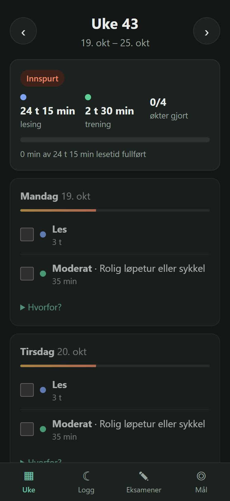 | 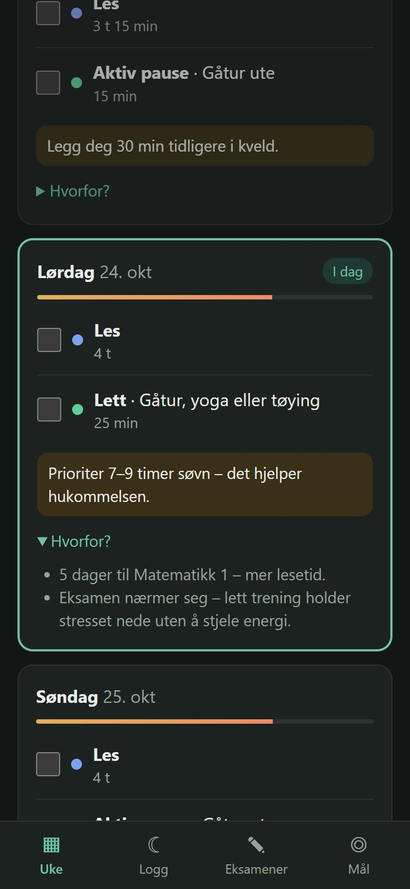 | 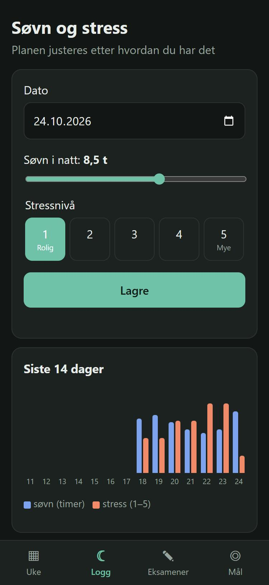 | 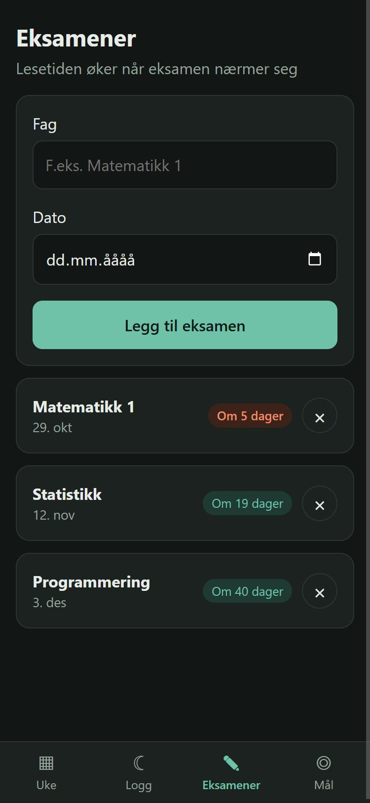 | 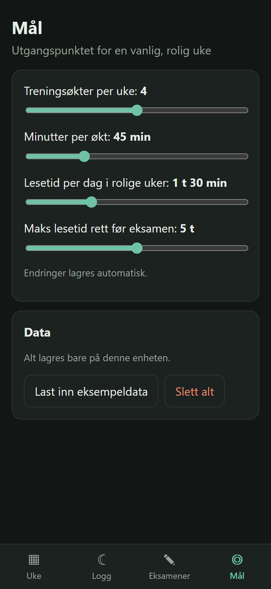 |

---

## Versjon 2 – lysere design, belønninger og temaer

### Tilbakemelding etter å ha prøvd versjon 1

- Appen var for mørk. Jeg ønsket et lysere uttrykk som motiverer mer til lesing, gjerne med et belønningssystem og streaks.
- Jeg ønsket å kunne velge mellom ulike temaer.
- Første versjon skulle bevares, og det skulle tas skjermbilder av alle sidene, slik at utviklingen kan dokumenteres i innleveringen.

### Hva KI-en gjorde

- **For mørk:** Versjon 1 fulgte telefonens mørke modus automatisk. Nå er standarden et lyst tema («Mint»).
- **Temaer:** Du kan velge mellom fem temaer under *Mål*: Mint, Fersken, Lavendel, Hav og Natt (mørkt, hvis man vil ha det).
  Valget lagres.
- **Streak:** Et kort øverst i ukeplanen viser «🔥 X dager på rad» med en motiverende tekst,
  for eksempel «Les i dag for å holde streaken på 5 dager!». Streaken ryker ikke før dagen er over.
- **Poeng og nivå:** Hver oppgave viser hvor mange poeng den gir (+23 p). Du får 10 poeng per leseøkt,
  pluss 1 poeng per 15 minutter lest, og 5 poeng per treningsøkt. 100 poeng gir et nytt nivå.
- **Merker:** Ny fane **Premier** med 9 merker som låses opp, for eksempel «På gang» (3 dager på rad),
  «10 timer» og «Balansert dag» (lese og trene samme dag).
- **Feiring:** Når du krysser av, kommer det en melding («🔥 5 dager på rad! +23 poeng») og konfetti.
  Det blir ekstra feiring når du låser opp et nytt merke eller går opp et nivå.
- Belønningslogikken ligger i en egen fil, `rewards.js`, med egne tester.
- Første versjon ble tatt vare på i `versjon-1/` og i git, og det ble tatt skjermbilder av alle sidene.

### Testing og forbedringer

- **12 automatiske tester**, som alle besto. De 6 nye sjekker streak (også over månedsskifte og når en dag hoppes over),
  poeng, nivå og merker.
- Testet i mobilstørrelse: avkrysning av lesing og trening, melding og konfetti, Premier-siden og alle temaene.
- **Feil funnet under testing og rettet:**
  - «16 t 30 min lest totalt» ble delt over to linjer på Premier-siden. Nå vises det som «16,5 t».
  - Natt-temaet så ut til å ha lys bakgrunn. Det viste seg at skjermbildet bare ble tatt midt i fargeovergangen,
    så det var ingen feil.

### Skjermbilder – versjon 2

| Uke med streak | Poeng per oppgave | Feiring (Fersken-tema) | Premier |
|---|---|---|---|
| 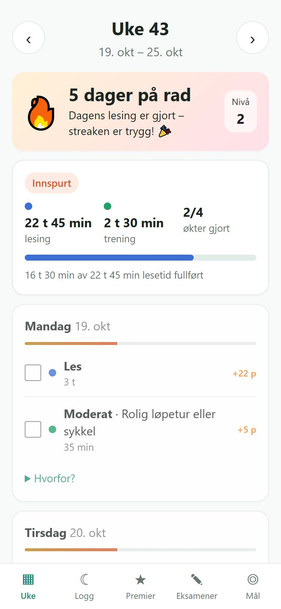 | 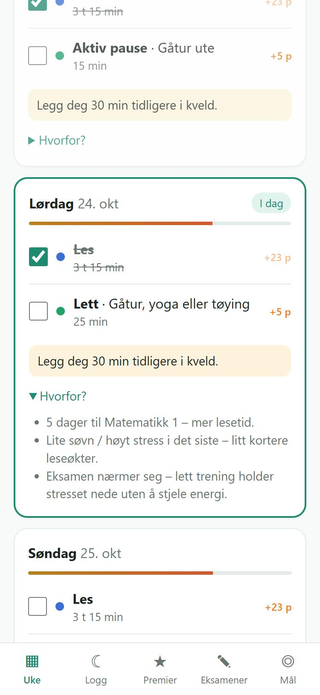 | 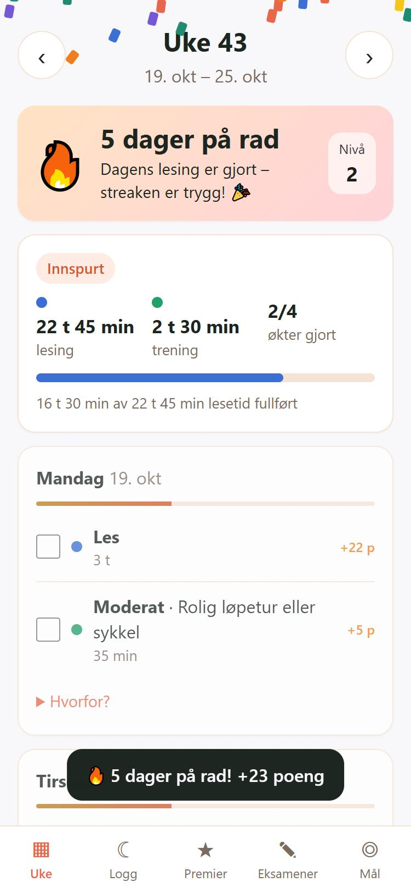 | 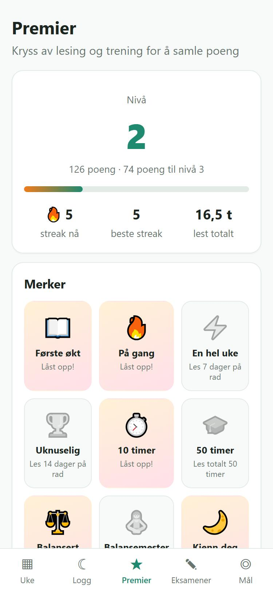 |

| Logg | Eksamener | Mål + temavelger | Lavendel-tema |
|---|---|---|---|
| 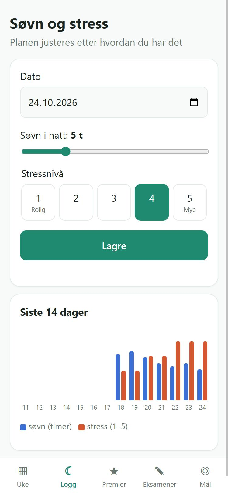 | 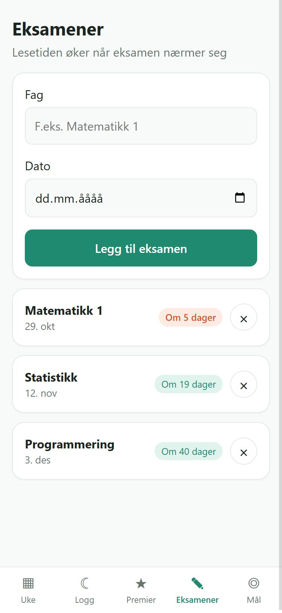 | 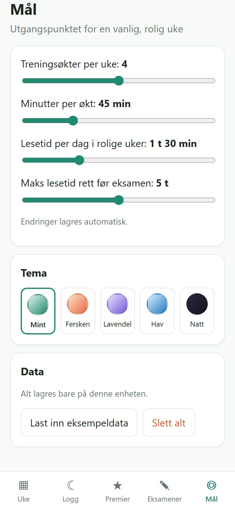 | 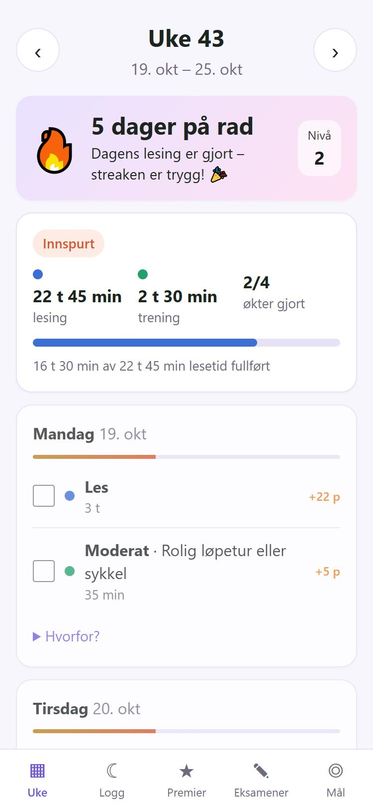 |

---

## Versjon 3 – timer, hage og egne treningsøkter

### Tilbakemelding etter å ha prøvd versjon 2

- Belønningssystemet med merker ga lite mening, fordi et merke som «Uknuselig» ikke sier noe om hva jeg faktisk har oppnådd.
  Jeg ønsket i stedet et system inspirert av studieapper som Forest, der man låser opp ting.
- Lesing burde registreres med en timer i stedet for avkrysning, siden avkrysning er lett å jukse med. Ved for eksempel
  45 minutter sammenhengende lesing skulle man vinne en konkret gjenstand som kan brukes til noe.
- KI-en skulle legge fram forslag i tekst før noe ble bygget.

Først kom KI-en med forslag i tekst, uten å bygge noe: en hage (inspirert av Forest), et studentrom eller et akvarium,
en tabell over hvilken plante du får for hvor lang økt, ting du kan vinne og hva de brukes til,
og spørsmålet om hvor streng appen skal være når man går ut av den. Deretter bestemte jeg følgende:

- Jeg valgte hagen og en «snill» modus.
- Når det gjaldt trening, ba jeg om KI-ens vurdering av om avkrysning er nok, eller om treningen burde være mer detaljert,
  med egne økter som kan redigeres per dag, for å redusere «decision fatigue».

### Hva KI-en gjorde

- **Timer i stedet for avkrysning for lesing.** Du trykker «▶ Les nå» og velger en plante. Lengden på økta avgjør planten:
  🌱 Spire 25 min, 🌷 Tulipan og 🌻 Solsikke 45 min, 🌳 Tre 60 min og 🌸 Kirsebærtre 90 min.
  Planten gror på skjermen mens nedtellingen går. Lesetiden i ukeplanen fylles bare av ekte timer-tid.
- **Snill modus mot juks.** Skjermen holdes på mens du leser. Du kan gå ut av appen i inntil 2 minutter.
  Er du borte lenger, eller trykker «Gi opp», visner planten 🥀. Den visne planten blir stående i hagen.
- **Hagen** erstatter merkene. Her ser du alle plantene dine, og været følger søvnloggen:
  ☀️ sol når du har sovet godt, 🌧️ regn når du har sovet lite eller er stresset.
- **Ting du vinner og kan bruke:**
  - 💧 **Vann** (når du har trent, maks én per dag) – trykk på en plante for å få den til å blomstre. Dette binder sammen lesing og trening.
  - 🌾 **Gjødsel** (etter 3 økter på én dag) – gir en gyllen plante ✨ neste økt.
  - 🧊 **Streak-frys** (for hver 7. dag på rad) – redder streaken automatisk hvis du glemmer en dag.
  - 🏵️ **Eksamensblomst** – når du fullfører en økt dagen før en eksamen.
  - 🪑 **Pynt** (benk, lykt, sommerfugler, froskedam, fontene og mer) – låses opp etter antall timer lest, og du plasserer den selv i hagen.
- **Frøkatalog**: viser alle plantene. De du ikke har ennå, vises som grå silhuetter med tekst om hva som skal til,
  for eksempel «Les 60 min i strekk». Da vet du alltid hva du jobber mot.
- **Trening uten «decision fatigue»**: Under *Mål* lager du dine egne økter for Hard, Moderat og Lett.
  Appen velger fra listene hver dag. I ukeplanen kan du bytte økt eller sette hviledag på hver dag. Trening krysses fortsatt av.
- Versjon 2 ble tatt vare på i `versjon-2/`.

### Testing og forbedringer

- **17 automatiske tester**, som alle besto. De 11 nye sjekker blant annet timeren (fortsetter, fullføres, visner etter 2 min),
  at visne planter ikke gir minutter, gjødsel, streak-frys, eksamensblomst, at vann bare kan fås én gang per dag, pynt,
  været og treningsmaler.
- Testet i mobilstørrelse: hele timer-flyten (velg plante → timer → fullført økt), en plante som visner etter 3 min borte,
  vanning av planter, plassering av pynt, bytte av treningsøkt og egne økter.
- **Feil funnet under testing og rettet:**
  - Himmelen øverst i hagen var usynlig når det regnet. CSS-klassen `rain` på himmelen kolliderte med regnlaget,
    som også het `rain` og var skjult. Klassene fikk nye navn.
  - Emojiene for gjødsel (🪴) og liljedam (🪷) vises som tomme firkanter på eldre enheter. De ble byttet til 🌾 og 🐸.
  - «Bytt…»-menyen for trening stakk ut av kortet. Den er flyttet under teksten.
  - En Hard økt valgt på en lett dag fikk bare 25 minutter. Nå styrer det valgte nivået minuttene.
  - Eksempeldataene brukte opp alt vannet, så det var ingenting å teste vanning med. Nå er det vann igjen.

### Skjermbilder – versjon 3

| Uke: timer + egen økt | Velg plante | Timeren går | Økt fullført |
|---|---|---|---|
| 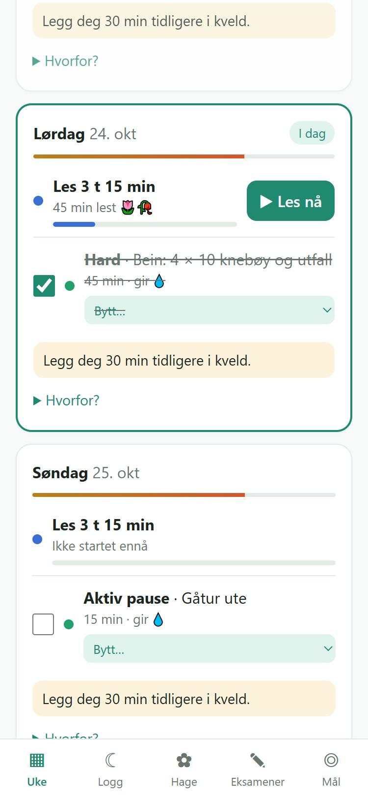 | 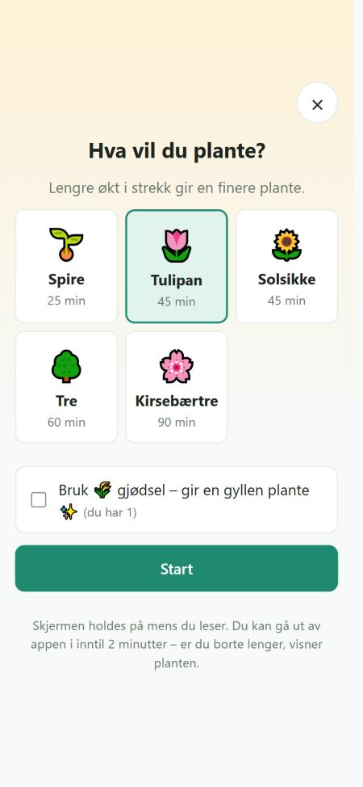 | 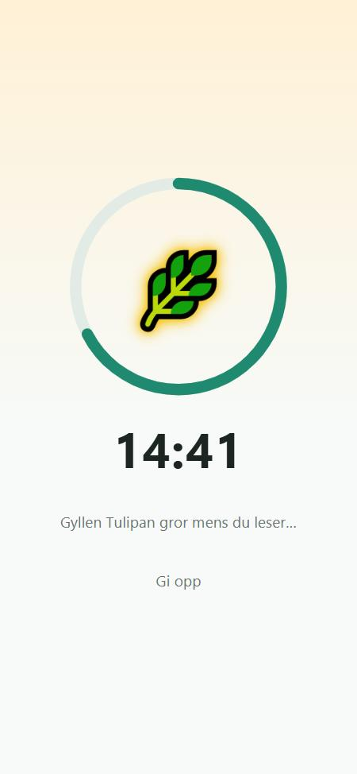 | 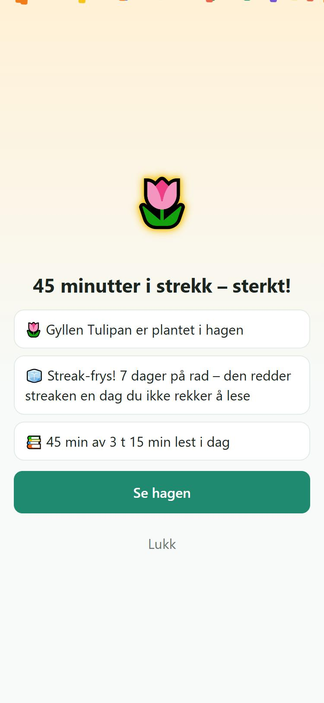 |

| Planten visnet | Hagen (regnvær) | Lager og pynt | Mine treningsøkter |
|---|---|---|---|
| 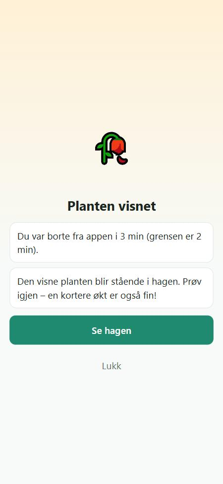 | 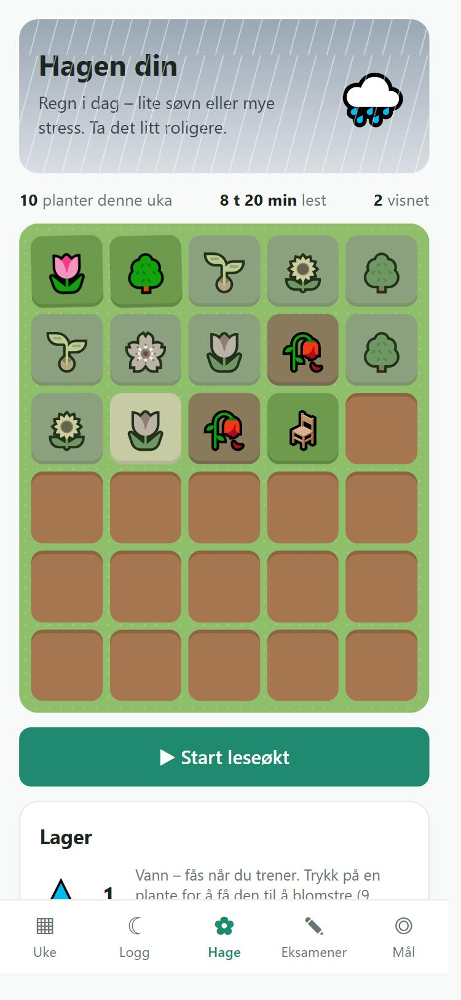 | 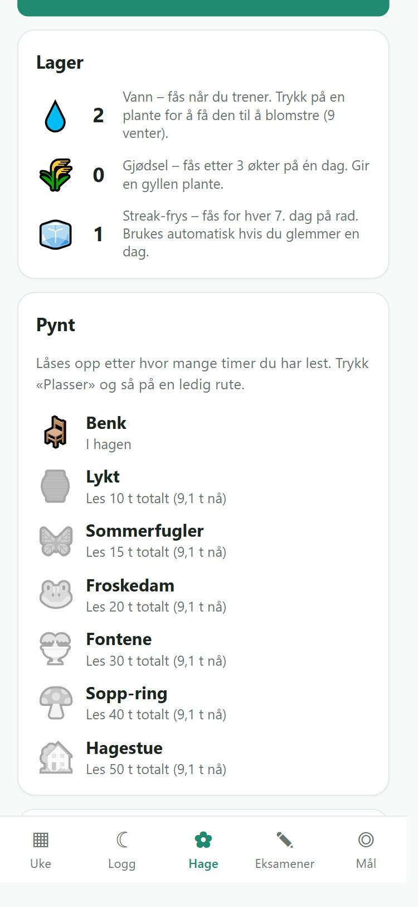 | 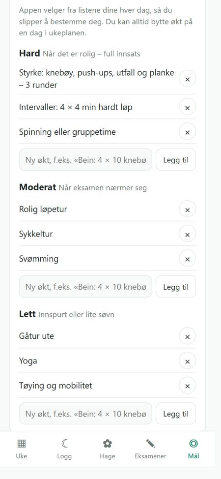 |

---

## Versjon 4 – minimalt og moderne design

### Tilbakemelding etter å ha prøvd versjon 3

Jeg la ved et skjermbilde av streak-kortet med den store flammen og ga denne tilbakemeldingen:

- Det store flammekortet fungerte ikke visuelt.
- Appen burde få et mer minimalt og moderne uttrykk.
- Emojiene burde erstattes.

### Hva KI-en gjorde

- **Det store flammekortet er borte.** Øverst er det nå en rolig rad med tre små nøkkeltall:
  dager på rad, planter denne uka og været i hagen, pluss én kort setning under.
- **Ingen emojier.** Emojier ser forskjellige ut på hver telefon, og på Windows ble de tykke og barnslige.
  Alt er erstattet med egne tegninger i `icons.js`:
  - strektegnede ikoner til menyen, knapper, lager og vær (flamme, spire, dråpe, snøfnugg, sol, sky og regn)
  - flate, enkle illustrasjoner av alle plantene (frø, spire, tulipan, solsikke, tre, kirsebærtre, eksamensblomst og visnet plante)
    og av pynten (benk, lykt, sommerfugler, dam, fontene, sopp og hagestue)
- **Mer moderne uttrykk:** skrifttypen Inter, en liten overskrift i store bokstaver over tittelen, roligere farger,
  mykere skygger, smalere fremdriftslinjer, runde «Les»-knapper og en fanemeny med uskarp bakgrunn.
- **Hagen** har lyse, nøytrale ruter i stedet for brun jord. Tørste planter vises grå til de blir vannet.
  Den store himmelen med regnanimasjon er byttet ut med en liten værmerkelapp.
- Versjon 3 ble tatt vare på i `versjon-3/`.

### Testing og forbedringer

- Alle **17 automatiske tester** består fortsatt, siden logikken ikke er endret.
- Et søk etter emojier i koden ga ingen treff.
- Testet i mobilstørrelse: ukeplanen, frøvelgeren, timeren, fullført økt, en økt der jeg ga opp, hagen, pynt, katalog og treningsøkter.
- **Feil funnet under testing og rettet:**
  - Plantetegningen inni timeren var rotert 90 grader. CSS-regelen som roterer fremdriftsringen traff også planten.
    Den gjelder nå bare selve ringen.
  - Nøkkeltallene ble delt over to linjer («7 dager / på rad»). Nå står tallet øverst og teksten under.
  - En kort inntoning når man byttet fane gjorde at skjermbildene ble blasse. Den ble fjernet, som passer med et mer minimalt design.
  - Teksten under timeren begynte med liten bokstav («solsikke gror…»).

### Skjermbilder – versjon 4

| Uke | I dag | Velg plante | Timer |
|---|---|---|---|
| 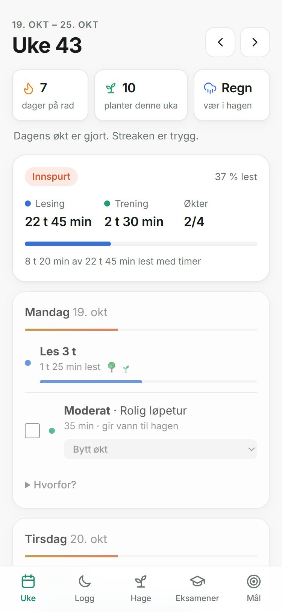 | 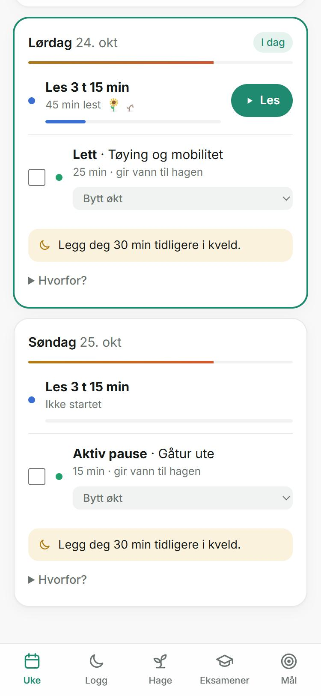 | 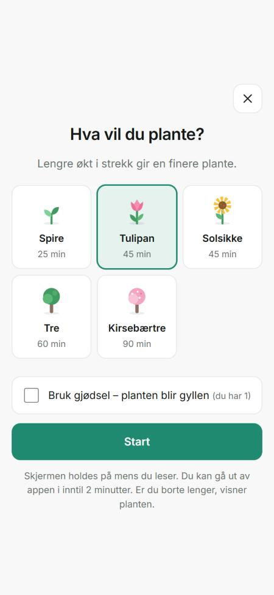 | 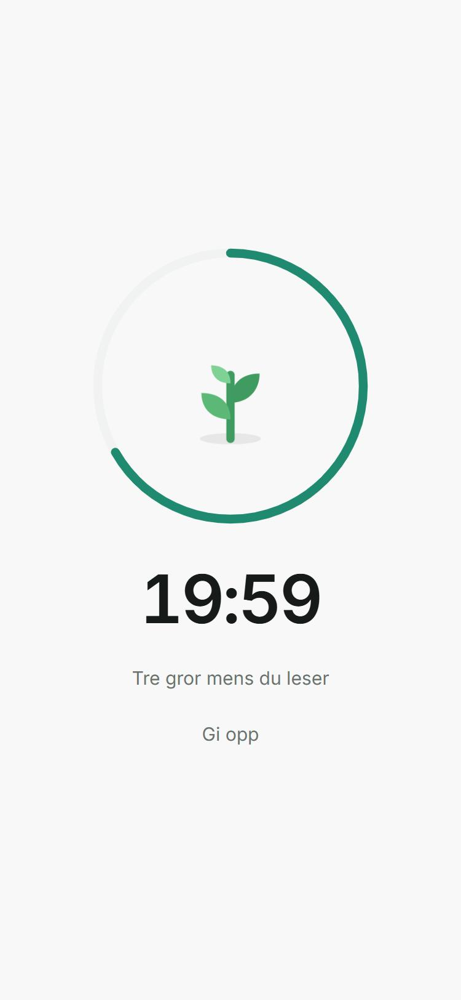 |

| Økt fullført | Hagen | Pynt og frøkatalog | Treningsøkter |
|---|---|---|---|
| 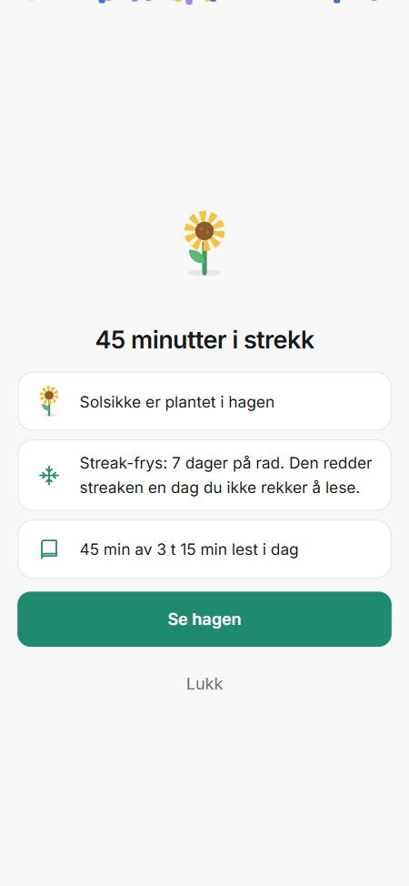 | 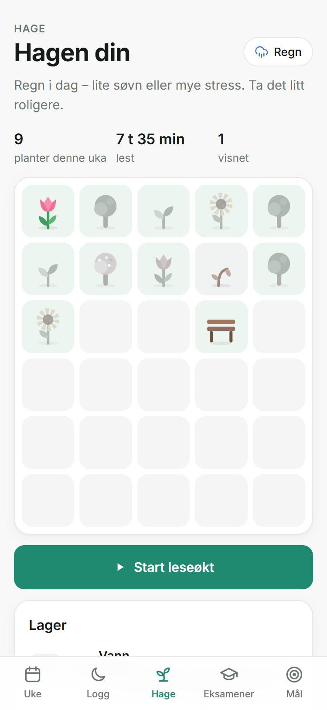 | 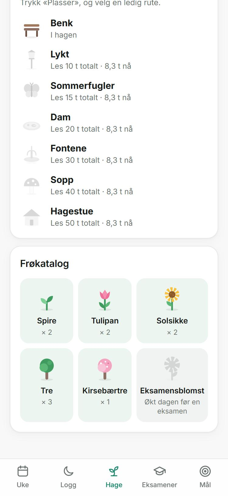 | 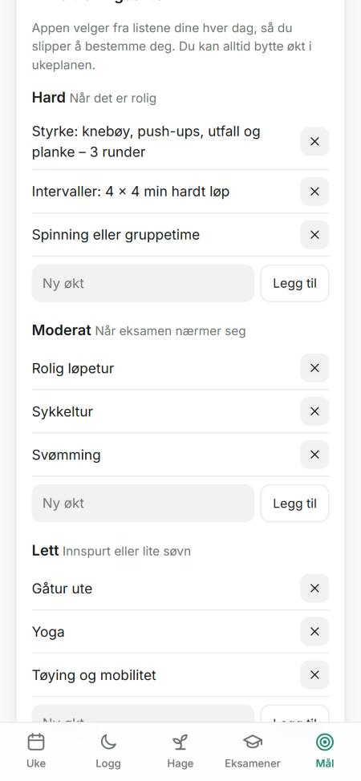 |

---

## Feilretting etter versjon 4 – «Gi opp» virket ikke

### Feilmelding

Jeg meldte fra om at ingenting skjedde når jeg trykket på «Gi opp».

### Hva som var galt

- «Gi opp» brukte nettleserens innebygde bekreftelsesboks (`confirm()`). I appens innebygde nettleser ble den stille blokkert
  og svarte «nei» med en gang, uten å vise noe. Det samme kan skje i enkelte nettlesere og installerte web-apper.
  Under KI-ens egne tester var `confirm()` overstyrt, så feilen ble ikke oppdaget før jeg prøvde selv.
- Etter rettingen fikk nettleseren fortsatt servert gamle filer. Service workeren hentet riktignok fra nettet først,
  men nettleserens HTTP-cache ga den gamle versjoner. Det ville også rammet ekte brukere etter hver oppdatering.

### Hva KI-en gjorde

- Lagde en egen bekreftelsesdialog inne i appen med «Avbryt» og en tydelig knapp («Gi opp», «Slett alt» osv.).
  Den brukes nå alle fire stedene som før brukte `confirm()`: gi opp, last inn eksempeldata, slett alt og flytt pynt.
- Service workeren ber nå alltid serveren sjekke om filene er nye (`cache: "no-cache"`), slik at oppdateringer når fram.

### Testing

- Først ble det bekreftet at `confirm()` faktisk returnerte «nei» på 1 ms uten å vise noe.
- Deretter ble «Gi opp» testet med ekte klikk: dialogen vises. «Avbryt» lar økta fortsette, og «Gi opp» får planten til å visne.
- Alle 17 automatiske tester består.

---

## Forbedring – gjenopplive visne planter

### Min tilbakemelding

Jeg spurte om visne planter blir stående i hagen for alltid, siden det kan virke demotiverende. Jeg foreslo at man burde kunne
fjerne dem, enten med poeng eller ved å lese like lenge som den opprinnelige planten krevde.

### Hva KI-en gjorde

- Poengsystemet ble fjernet i versjon 3, så vi valgte det andre forslaget: **du gjenoppliver en vissen plante ved å lese like lenge
  som den opprinnelige planten krevde.**
- Trykk på en vissen plante i hagen. Da kommer for eksempel «Gjenoppliv planten? Les 60 min i strekk, så blir den til et tre igjen».
  Med «Start økt» starter timeren med riktig plante og lengde.
- Fullfører du, blir den visne planten til den opprinnelige planten igjen **i samme rute**. Minuttene teller på dagen du leste,
  og streak, gjødsel og pynt fungerer som vanlig.
- Gir du opp eller er borte for lenge under et gjenopplivingsforsøk, blir det **ikke** en ny vissen plante.
  Den gamle står bare der til du prøver igjen. Det skal ikke være straff å prøve.
- Skjermen for en vissen plante forteller nå at den kan gjenopplives, og hvor lenge du må lese.

### Testing og forbedringer

- **2 nye automatiske tester**, så nå er det 19 som alle består. Den ene sjekker at planten gjenopplives i samme rute
  og at minuttene teller riktig. Den andre sjekker at et mislykket forsøk ikke lager en ny vissen plante.
- Testet i nettleseren: Jeg trykket på en vissen plante og fullførte en gjenopplivingsøkt.
  Antall visne planter gikk fra 4 til 3, og det totale antallet planter var det samme.
- **Feil funnet og rettet:** Teksten sa «en tre». Plantene har nå riktig kjønn, så det står «et tre» og «et kirsebærtre».
- Knappen i bekreftelsesdialogen er rød bare for handlinger du ikke kan angre, som «Gi opp» og «Slett alt».
  For «Start økt» er den grønn.

---

## Forbedring – én treningsøkt vanner hele hagen

### Min tilbakemelding

Jeg spurte hvorfor så mange planter var tørste, og om man måtte trene mer enn fire ganger i uka for å ta igjen plantene.

KI-en forklarte at det var en svakhet i designet. Man fikk én plante per leseøkt (ofte 2–4 om dagen), men bare én vanndråpe
per treningsdag, og hver dråpe vannet bare én plante. Med 4–5 treninger i uka kunne man aldri ta igjen plantene.
I eksamensuker ble det verst, fordi appen selv anbefaler mer lesing og lettere trening, så hagen straffet deg for å følge planen.
KI-en foreslo to løsninger, og jeg valgte at én treningsøkt skal vanne hele hagen.

### Hva KI-en gjorde

- Når du krysser av for trening, blomstrer **alle** tørste planter i hagen på én gang. Du får en melding som
  «Hagen er vannet – 2 planter blomstrer».
- Har du allerede trent i dag, blomstrer planter du får resten av dagen med én gang.
- Vanndråpene i lageret er fjernet, fordi de ikke trengs lenger. I stedet viser lageret hvor mange planter som er tørste.
- Grå planter betyr nå bare «du har lest, men ikke beveget deg siden sist», og én treningsøkt fikser det.

### Testing

- **2 nye automatiske tester**, så nå er det 20 som alle består. Den ene sjekker at én økt vanner alle seks tørste planter
  og ikke de visne. Den andre sjekker at planter som gror etter dagens trening blomstrer med én gang, men ikke neste dag.
- Testet i nettleseren med eksempeldata: Før treningen var det 8 blomstrende og 2 tørste planter.
  Etter at dagens trening ble krysset av, blomstret alle 10.

---

## Forbedring – tydeligere ukemål

### Min tilbakemelding

Jeg la ved et skjermbilde av oppsummeringskortet («Innspurt · Lesing 22 t 30 min · Trening 2 t 40 min · Økter 1/4») og spurte
hva tallene betydde, og om 22 t 30 min lesing og 2 t 40 min trening var det som allerede var gjort denne uka.

### Hva som var uklart

De store tallene var det som var **planlagt** for hele uka, ikke det som var gjort. Det du faktisk hadde gjort,
sto bare i en liten linje nederst. «Innspurt» ble heller ikke forklart.

### Hva KI-en gjorde

- Kortet heter nå **Ukemål** og viser **gjort av planlagt** for både lesing og trening, for eksempel
  «Lest 8 t 20 min av 22 t 30 min» og «Trent 1 t 5 min av 2 t 40 min · 1 av 4 økter». Hver har sin egen fremdriftslinje.
- Under tittelen står det hvorfor uka ser slik ut, for eksempel «Matematikk 1 om 5 dager.
  Planen for uka er regnet ut fra eksamenene og søvnen din».

### Testing

- Kontrollert i nettleseren i mobilstørrelse at tallene stemmer med det som er gjort i eksempeldataene, og at teksten ikke brytes stygt.
- Alle 20 automatiske tester består.

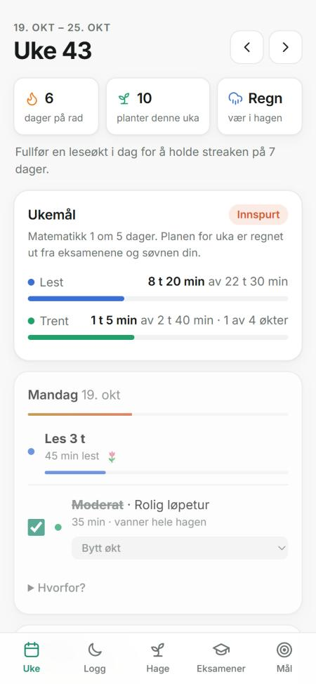

---

## Forbedring – tryggere sletting og «Innstillinger»

### Min tilbakemelding

- Slettekryssene for treningsøkter under «Mål» var for lette å trykke på ved et uhell.
- Fanen «Mål» burde få et tydeligere navn som viser at man kan endre innstillinger der, siden den også inneholder blant annet tema.

### Hva KI-en gjorde

- **Sletting må bekreftes.** Trykker du × på en treningsøkt, kommer dialogen «Slette "Yoga" fra Lett?» med «Avbryt» og en rød «Slett».
  Eksamenslisten hadde den samme lille ×-knappen og fikk samme bekreftelse, for eksempel «Slette eksamenen i Matematikk 1 (30. okt)?».
  Etter sletting kommer en kort bekreftelse nederst på skjermen.
- **«Mål» heter nå «Innstillinger».** Fanen har et ikon med skyveknapper, og siden har overskriften «Tilpass appen / Innstillinger».
  Den er delt i tydelige deler: *Mål for uka*, *Mine treningsøkter*, *Tema* og *Data*.

### Testing

- Testet i mobilstørrelse:
  - «Avbryt» lar treningsøkta være, og «Slett» fjerner den.
  - Eksamenslisten spør før den sletter.
  - «Innstillinger» får plass i fanemenyen.
- Under testingen ble det oppdaget at én treningsøkt allerede manglet i Hard-listen. Den var sannsynligvis slettet ved et uhell tidligere,
  noe som viser at endringen var nødvendig.
- Alle 20 automatiske tester består.

---

## Versjon 5 – fag, obliger, påminnelser og dagens oppgaver

### Min tilbakemelding

Jeg ønsket hjelp til å velge hva jeg skal lese hver dag, og foreslo at man skulle kunne:
- rangere fagene etter vanskelighetsgrad eller prioritet
- legge inn frister
- legge inn dagens studieoppgaver

KI-en foreslo først en plan i fire deler før den bygde noe: fag med vanskelighetsgrad og frister, forslag til hva du bør lese i dag,
dagens oppgaver, og at timeren vet hvilket fag du leser. Jeg la til at hvert fag bør ha en egen fane for obligatoriske oppgaver
og fristene deres, med påminnelser.

### Hva KI-en gjorde

- **«Eksamener» ble «Fag».** Hvert fag har navn, vanskelighetsgrad (lett, middels eller vanskelig) og eksamensdato.
  Eksamener som var lagt inn fra før, ble automatisk gjort om til fag, så ingenting gikk tapt.
- **Hvert fag har sin egen side med to faner:**
  - *Oversikt*: lesetid denne uka og totalt, vanskelighetsgrad, eksamensdato og navn.
  - *Obliger*: oppgaver med frist, påminnelse (samme dag, 1 dag, 3 dager eller 1 uke før), «Levert»-avkrysning og «Legg i kalender».
- **Hva skal jeg lese i dag?** Dagens lesetid fordeles på de 1–3 viktigste fagene ut fra vanskelighetsgrad og hvor nær eksamen
  eller frist er, for eksempel «Matematikk 1 · 1 t 45 min · eksamen om 5 dager». Hvert fag har en «Les»-knapp som starter timeren med det faget.
- **Frister påvirker planen.** En oblig gir mer lesetid når fristen nærmer seg, men teller litt mindre enn en eksamen.
- **Påminnelser på tre måter:**
  1. Et «Frister»-kort øverst i ukeplanen når en frist er innenfor påminnelsen eller på overtid, med «Levert»-knapp.
  2. Varsel på telefonen når du åpner appen, hvis du slår det på under Innstillinger.
  3. «Legg i kalender» lager en kalenderfil med alarm, så telefonen varsler selv når appen er lukket.
     En web-app uten server kan ikke sende varsler mens den er lukket, så dette var den sikreste løsningen.
- **Dagens oppgaver:** en sjekkliste på dagens kort, der hver oppgave kan knyttes til et fag. Uferdige oppgaver flytter seg
  automatisk til neste dag og merkes «fra i går».
- **Timeren vet hvilket fag du leser.** Det foreslåtte faget er valgt på forhånd og kan byttes. Lesetiden telles per fag.
- Versjon 4 ble tatt vare på i `versjon-4/`.

### Testing og forbedringer

- **8 nye automatiske tester**, så nå er det 28 som alle består. De sjekker:
  - at lesetiden fordeles på riktige fag og summerer riktig
  - at en frist løfter faget
  - at ferdige fag ikke foreslås
  - at obliger teller i planen uten å bli behandlet som eksamensdager
  - påminnelser
  - innholdet i kalenderfilen
  - at uferdige oppgaver flytter seg
- Testet i nettleseren i mobilstørrelse:
  - Gamle eksamener ble gjort om til fag.
  - En ny oblig med frist i morgen flyttet faget opp i dagens forslag.
  - «Levert» fjernet fristen og senket faget i forslagene.
  - Både «Les» og fagforslaget velger riktig fag i timeren.
  - Oppgaver kan legges til og krysses av.
- **Feil funnet og rettet:**
  - Når en eksamen og en frist var nær samme dag, nevnte «Hvorfor?» bare eksamenen. Den automatiske testen fant dette,
    og nå nevnes frister med forfall den dagen alltid.
  - Fagforslagene ble klemt sammen ved siden av «Les»-knappen og er flyttet under, så de får hele bredden.
  - «Slå på varsler» var trykkbar selv når nettleseren hadde blokkert varsler. Nå er knappen deaktivert, og det står hvorfor.

### Skjermbilder – versjon 5

| Frister og ukemål | Dagens fag og oppgaver | Fagene dine |
|---|---|---|
| 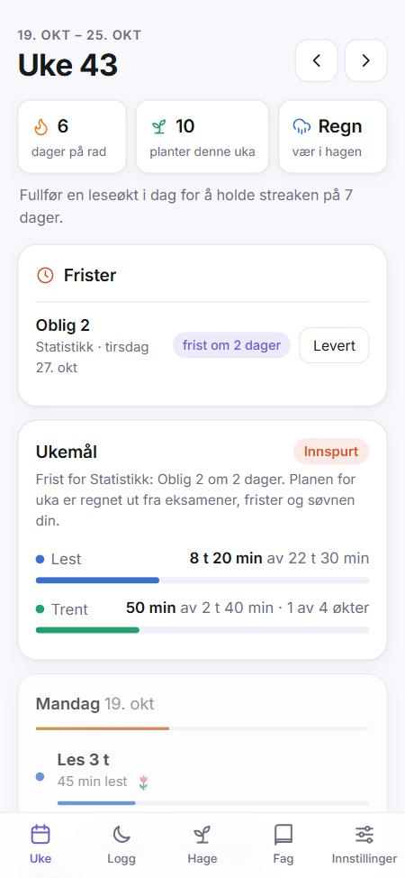 | 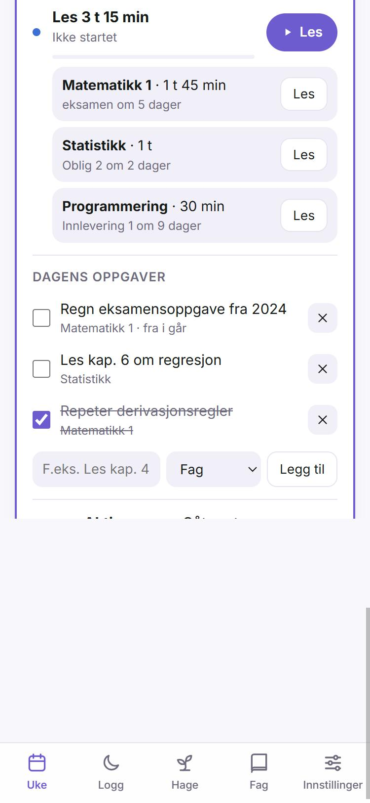 | 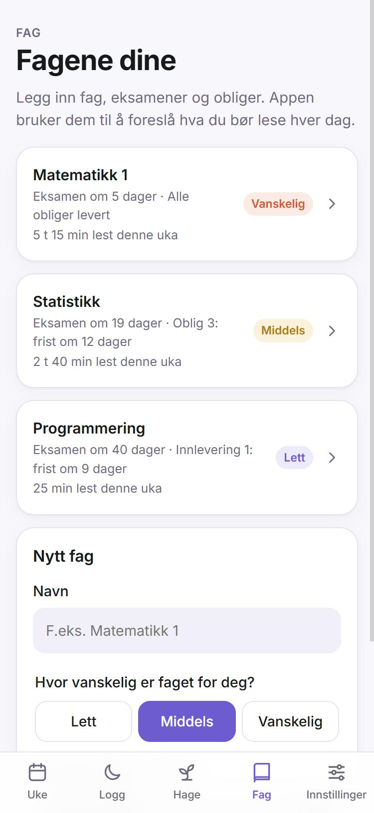 |

| Obliger i et fag | Velg fag i timeren | Påminnelser |
|---|---|---|
| 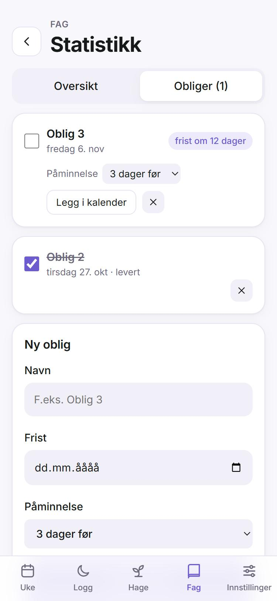 | 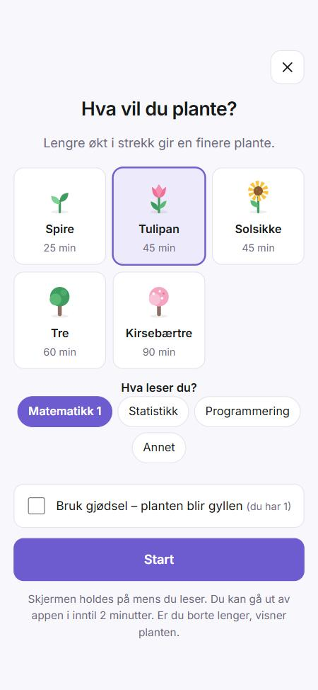 | 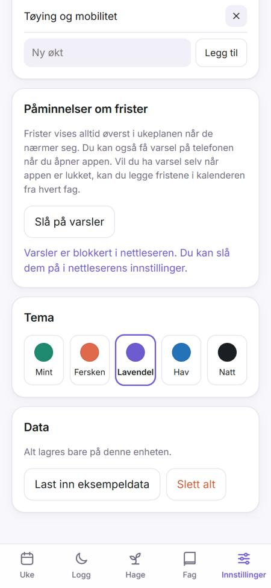 |

---

## Forbedring – «Levert» som avkrysning

### Min tilbakemelding

Jeg påpekte at knappen «Levert» så ut som en status som sier at jeg allerede har levert, og ikke som noe man krysser av.

### Hva KI-en gjorde

- «Levert»-knappen i Frister-kortet er byttet ut med en avkrysningsboks foran hver frist, slik oppgavene og obligfanen har.
- Nederst i kortet står det «Kryss av når du har levert».
- Meldingen etterpå sier «… er markert som levert», så det er tydelig at det er noe du gjorde, ikke en status appen satte.

### Testing

- En midlertidig testoblig med frist i morgen ble lagt inn og krysset av med et ekte klikk. Den forsvant fra Frister-kortet
  og ble lagret som levert. Etterpå ble den fjernet igjen.

---

## Forbedring – egen datovelger

### Min tilbakemelding

Jeg syntes nettleserens innebygde datovelger så gammeldags ut, og ba om en mer moderne og pen kalender.

Det første forsøket var en kalender som gled opp fra bunnen og dekket halve skjermen. Jeg påpekte at den var altfor stor,
og ba om samme størrelse som den opprinnelige, men med det nye utseendet.

### Hva KI-en gjorde

- Nettleserens innebygde datovelger («dd.mm.åååå» og en grå kalender som ser forskjellig ut på hver enhet) er byttet ut
  med en egen datovelger alle fire stedene: logg, nytt fag, eksamensdato og oblig-frist.
- **Datofeltet** viser datoen pent, for eksempel «Fredag 30. oktober», med et kalenderikon. Er feltet tomt, står det for eksempel «Velg frist».
- **Kalenderen:**
  - åpner seg rett under feltet, eller over hvis det ikke er plass nedenfor, og er omtrent like stor som den gamle (ca. 290 px bred)
  - har norske ukedager, mandag først, og I dag har en ring rundt
  - viser valgt dag fylt med farge, og små prikker på dager som allerede har en eksamen eller frist
  - har snarveiene «I dag», «I morgen», «Om en uke» og «Om to uker»
  - velger dagen og lukkes med ett trykk, og lukkes også når du trykker utenfor
  - har «Fjern dato» der datoen er valgfri
- **Første versjon var for stor**, en bunnark over halve skjermen. Etter tilbakemeldingen ble den gjort om til en liten kalender ved feltet.

### Testing

- Testet i mobilstørrelse:
  - Du kan velge dag, bla til neste måned og bruke snarveiene.
  - Kalenderen lukkes når du trykker utenfor.
  - Den åpner seg over feltet når feltet ligger langt nede på skjermen.
  - Feltet viser riktig dato etterpå.
- Det skjulte datofeltet støtter ikke «påkrevd felt», så appen sjekker nå selv at obligen har fått en frist, og åpner kalenderen hvis den mangler.
- Alle 28 automatiske tester består.

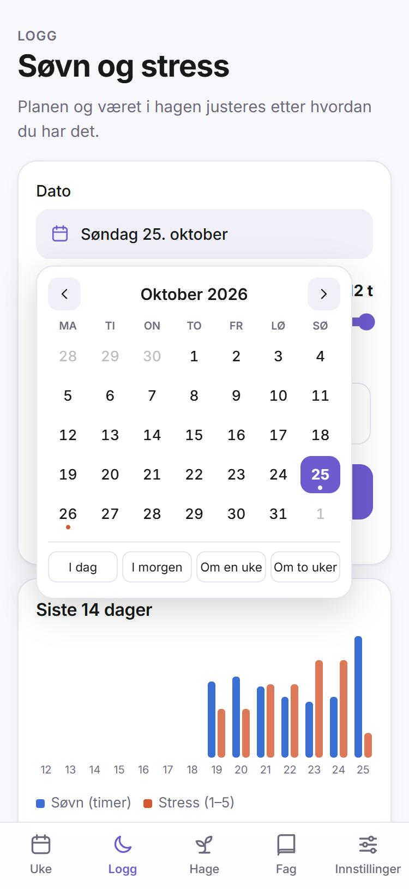

---

## Demovideo til innleveringen

### Hva KI-en gjorde

- KI-en leste instruksjonene til VibeOff. VibeOff lager videoen ved å la agenten laste ned og kjøre et skript fra nettsiden deres.
  KI-en kjører ikke programmer fra ukjente kilder på maskinen min, så den lagde videoen selv i stedet.
- **Fremgangsmåte:**
  1. Dataene mine ble sikkerhetskopiert, og eksempeldata ble lastet inn.
  2. KI-en gikk gjennom appen i mobilstørrelse og tok 12 skjermbilder: ukeplan, dagens fag og oppgaver, fag, obliger, datovelger,
     velg plante, timer, fullført økt, gi opp, vissen plante, tørste planter og hagen etter trening.
  3. En liten nettside ([`demovideo/lag-video.html`](demovideo/lag-video.html)) tegner hver scene med telefonen til høyre og en
     forklaring til venstre. Den koder videoen med nettleserens innebygde videokoder (WebCodecs, VP8) og pakker den som WebM.
  4. Dataene mine ble lagt tilbake etterpå.
- **Resultat:** [`balanse-demo.webm`](balanse-demo.webm), 47 sekunder, 1280×720 og 2,7 MB. Den passer både for YouTube
  og for VibeOff-grensen på 8 MB.

### Problemer underveis

- **Første forsøk ble feil.** Det tok opp lerretet i sanntid (MediaRecorder). Nettleserpanelet tegnet ikke siden mens Claude-vinduet
  lå bak et annet vindu, så videoen ble 47 sekunder lang med bare to ulike bilder.
  Dette ble oppdaget ved å sammenligne bilder fra ulike tidspunkter i videoen.
  Løsningen var å kode hvert bilde direkte med faste tidsstempler, så resultatet ikke er avhengig av at skjermen tegnes.
- **Kontroll:** Videobildene ble dekodet igjen og sammenlignet (22 ulike bilder fra 35 nøkkelbilder). Et utsnitt av scenene ble
  lagret som bilde og sjekket.
- **Feil i appen funnet under opptaket:** Meldingen «Velkommen tilbake. Planten lever fortsatt.» ble liggende på skjermen samtidig
  som det sto «Planten visnet». Nå fjernes gamle meldinger når en økt avsluttes.
- **Layout i videoen:** Avstanden mellom tittel og tekst ble for stor når tittelen fikk plass på én linje. Teksten plasseres nå rett under tittelen.

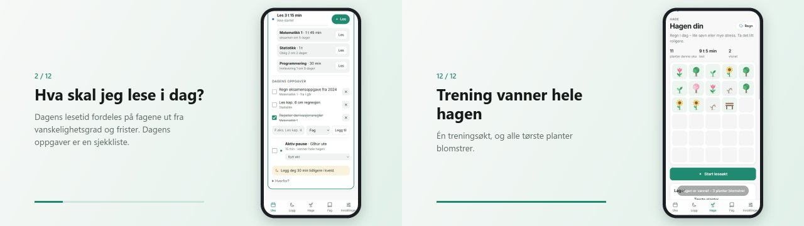

### Utkast på VibeOff

Jeg ba KI-en sende et utkast til VibeOff med videoen, og bekreftet at appen oppfyller VibeOffs regler.

- KI-en lagde et forsidebilde på 1280×800 ([`vibeoff-forside.png`](vibeoff-forside.png)) med tittel, tre telefonskjermer og tre påstander,
  og registrerte seg som agent hos VibeOff.
- Den sendte et **utkast**, ikke en publisering, med forsidebildet og demovideoen.
  Teksten besto av tittel, sammendrag, hvordan appen ble laget, hva som fungerte, et spørsmål, veien videre og viktigste prompt.
- Alle bildene ble sjekket for personopplysninger før opplasting. De bruker bare eksempeldata.
- **Publisert** av meg (brukernavn @meem03, uten ekte navn eller e-post):
  <https://vibeoff.ai/build/jeg-lagde-en-ukeplan-der-lesing-gror-en-hage-og-trening-ed6ecfbc>.
  KI-en sjekket etterpå at siden er offentlig, og at videoen er med.

---

## Feilretting – hagen på iPhone

### Min tilbakemelding

Etter at appen ble lagt ut på GitHub Pages, testet jeg den på iPhone. Jeg sendte et skjermbilde som viste at hagen ble vist feil
når jeg hadde gitt opp en økt og gikk til hagen.

### Hva som var galt

Hagerutene var for brede, så rutenettet gikk ut over skjermkanten. «Hagen din» ble kuttet til venstre,
og den nederste raden lå over «Start leseøkt»-knappen. Årsaken var en forskjell i Safari:
- Kolonner med `1fr` krymper ikke under «naturlig» bredde på innholdet.
- En SVG-tegning uten fast størrelse får en innebygd bredde på 300 px.

Chrome, som ble brukt under testingen, viser dette riktig, og derfor ble ikke feilen oppdaget før appen ble testet på en ekte iPhone.

### Hva KI-en gjorde

- Alle 15 rutenett i appen bruker nå `minmax(0, 1fr)`, så kolonnene alltid kan krympe til skjermbredden.
- Plantetegningene og hagerutene kan ikke lenger bli bredere enn kolonnen sin.
- Eldre Safari uten `aspect-ratio` får en fast rutehøyde, så rutene holder seg kvadratiske.

### Testing

- Feilen kan ikke gjenskapes direkte i Chrome. Derfor ble Safari sin oppførsel simulert ved å gi plantetegningene tvunget bredde på 300 px.
  Rutenettet holdt seg innenfor skjermen, alle ruter var 60 × 60 px, og siden ble ikke bredere enn 375 px.
- Underveis gikk en automatisk erstatning i CSS-en galt, og alle kolonnetallene forsvant (`repeat(, …)`). Dette ble oppdaget med en gang
  og rettet med et eget skript som setter inn riktig tall for hvert rutenett.
- Bekreftet på iPhone etter at rettingen var lagt ut: hagen vises nå riktig og holder seg innenfor skjermen.

---

## Neste versjon

*(Legg til nye runder her: hva du ba om, hva som ble endret, og hvordan det ble testet.)*
